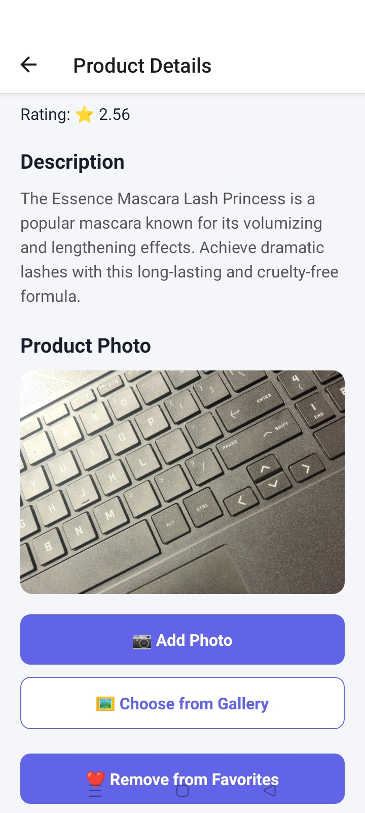
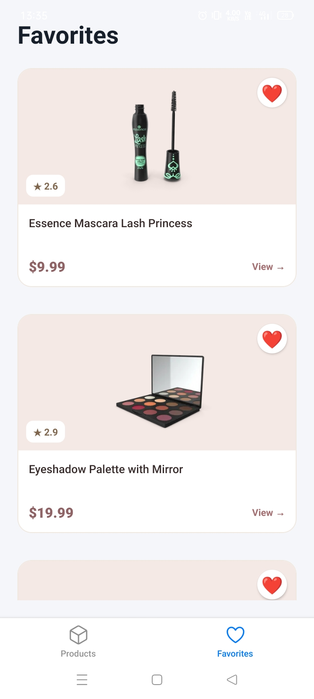

# Catalog App

## Overview

Catalog is a mobile product catalog application built with React Native, Expo, and TypeScript. It allows users to browse products, view product details, manage favorites, and capture and save product photos.

## Features

- Browse products from the DummyJSON API.
- Search products by title.
- View detailed product information.
- Add and remove products from Favorites.
- Capture and save product photos using the device camera.
- Pull to refresh the product list.
- OTA updates using EAS Update.
- Android APK and AAB builds using EAS.

## Screenshots

### Products Screen


### Product Detail Screen (with saved photo)



### Favorites Screen



## Tech Stack

| Technology   | Purpose                        |
| ------------ | ------------------------------ |
| React Native | Mobile application development |
| Expo SDK 58  | App development platform       |
| TypeScript   | Type safety                    |
| Expo Router  | File-based navigation          |
| EAS Build    | Cloud Android builds           |
| EAS Update   | Over-the-air updates           |
| DummyJSON    | Product API                    |

## Setup

### Prerequisites

- Node.js and npm
- Git
- Expo account

### Installation

Clone the repository:

```bash
git clone https://github.com/QuantekSolutions/soniya-intern-app.git
cd catalog
```

Install dependencies:

```bash
npm install
```

Create your environment file from the example:

Windows PowerShell:

```powershell
Copy-Item .env.example .env
```

Set the API URL in `.env`:

```env
EXPO_PUBLIC_API_URL=https://dummyjson.com
```

Start the application:

```bash
npx expo start
```

## Builds

### 1. Local Gradle Builds

Local Android builds require Android SDK, JDK, and the project's Android build configuration.

From the project root:

```powershell
cd android
.\gradlew.bat assembleRelease
```

To run a clean release build:

```powershell
.\gradlew.bat clean
.\gradlew.bat assembleRelease
```

### 2. EAS Cloud Builds

Install EAS CLI:

```bash
npm install -g eas-cli
```

Log in:

```bash
eas login
```

Build an Android development client:

```bash
eas build --platform android --profile development
```

Generate a preview APK:

```bash
eas build --platform android --profile preview
```

Generate a production AAB:

```bash
eas build --platform android --profile production
```

### 3. OTA Updates

Publish an update to the preview channel:

```bash
eas update --channel preview --environment preview --platform android --message "Update app UI"
```

OTA updates can deliver compatible JavaScript and asset changes without generating a new native build. Native code or native configuration changes require a new build.

### 4. Preview APK

The preview APK can be installed directly on compatible Android devices.

[**Download Catalog Preview APK**](https://expo.dev/artifacts/eas/FZpJ4e6i5l466eug7TUqN71pAwB7Im7QNhbu8IHgwvc.apk)

## Gradle vs EAS Build Comparison

| Factor                | Local Gradle                                                          | EAS Build                                                             |
| --------------------- | --------------------------------------------------------------------- | --------------------------------------------------------------------- |
| Speed                 | Usually faster for repeated local builds when dependencies are cached | Depends on cloud queue, build resources, and cache                    |
| Setup effort          | Higher; Android SDK, JDK, and local configuration required            | Lower; EAS CLI, Expo account, and project configuration required      |
| Cost and queue limits | No EAS queue; uses local hardware and electricity                     | Free and paid plan limits, build quotas, and queue priority may apply |
| Signing control       | Direct control over local keystore and signing configuration          | EAS can manage signing credentials or use supplied credentials        |
| Android SDK and JDK   | Required locally                                                      | Managed by the EAS build environment                                  |
| Reproducibility       | Can vary with local machine configuration and installed tools         | More consistent when build configuration and dependencies are pinned  |
| CI/CD                 | Possible, but requires configuring Android tooling and credentials    | Integrates with cloud build and automation workflows                  |

### When to Use Local Gradle

Use local Gradle when:

- Debugging native Android or Gradle issues.
- Working offline after dependencies are available.
- Testing native changes quickly.
- You need direct control over the local build environment and signing configuration.

### When to Use EAS

Use EAS when:

- You need clean, reproducible cloud builds.
- Team members do not have Android SDK and JDK configured.
- Building through CI/CD workflows.
- Generating preview APKs for testers.
- Preparing production builds for store distribution.

### Important: Android Signing Compatibility

An APK signed with an EAS-managed keystore may have a different signing certificate from an APK signed with a local keystore.

Android does not allow an app to be updated by an APK signed with a different certificate, even if both APKs use the same application ID.

This can cause:

```text
INSTALL_FAILED_UPDATE_INCOMPATIBLE
```

To install an APK signed with a different key, uninstall the existing app first. This may remove its locally stored app data.

For updates without uninstalling, use builds signed with the same keystore.

## Code Quality Checks

Run ESLint:

```bash
npx eslint .
```

Run TypeScript checks:

```bash
npx tsc --noEmit
```

## Project Configuration

- Expo account: `soniya_meena`
- EAS project: `@soniya_meena/catalog`
- Android package: `com.soniya.catalog`
- App version: `1.0.1`
- API: `https://dummyjson.com`

Environment variables should be configured in `.env` locally and in the appropriate EAS environments for cloud builds.

Never commit `.env`, keystore files, or signing passwords to GitHub.

## Release Status

- [x] EAS project configuration
- [x] Preview APK generated and tested
- [x] OTA update tested
- [x] Production AAB generated
- [x] Keystore backup
- [x] ESLint verification
- [x] TypeScript verification
- [ ] Play Store submission

---

Built with React Native and Expo.
