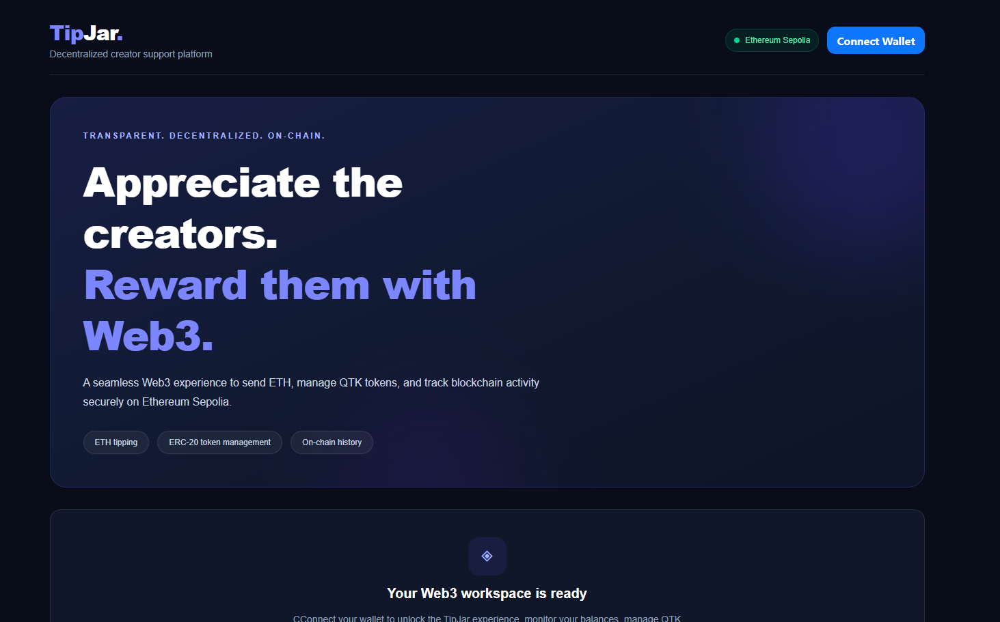
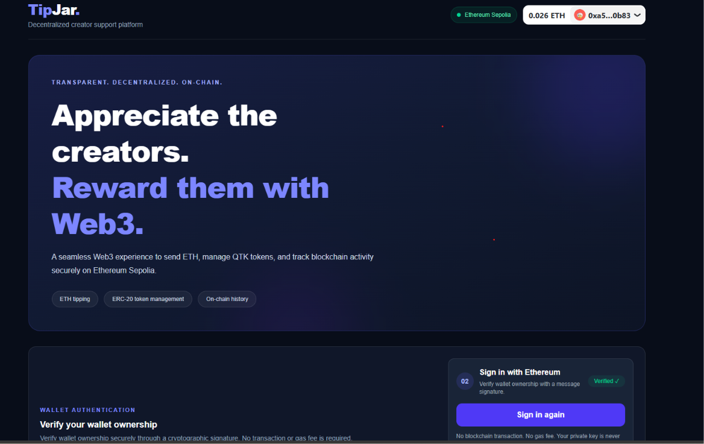
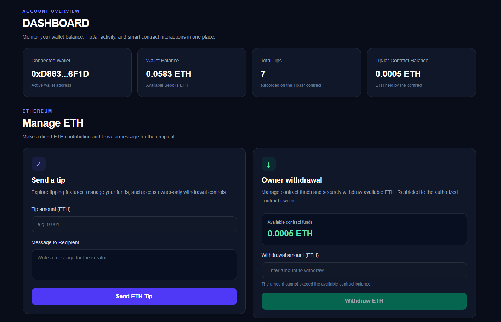
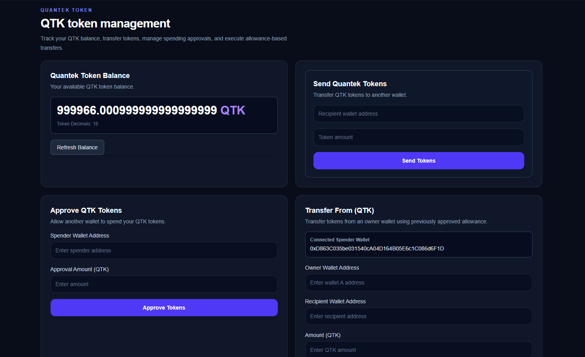
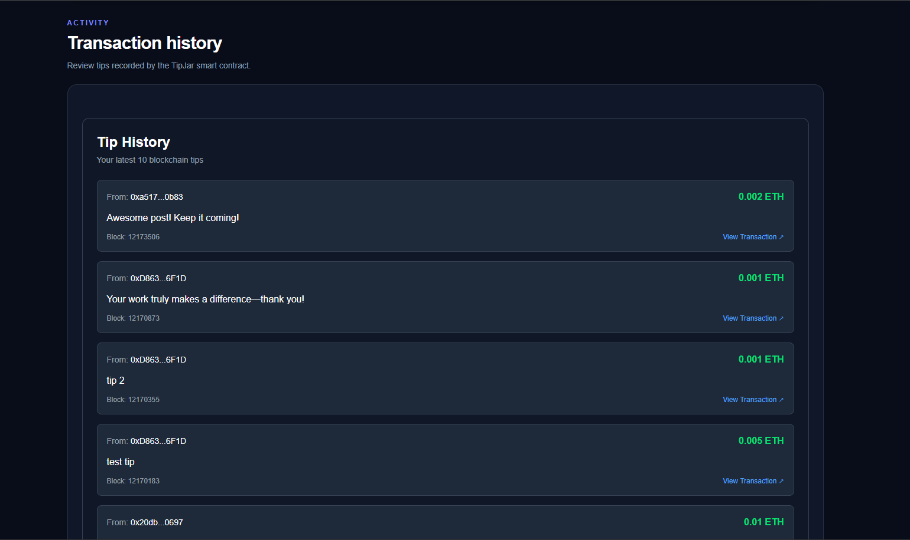

# TipJar dApp – Frontend

## 1. Overview

TipJar is a blockchain-based decentralized application (dApp) that enables users to send ETH tips along with personal messages directly through their connected Ethereum wallets.

Built with Next.js and integrated with Ethereum smart contracts deployed on the Sepolia testnet, the application also provides QTK token management, wallet authentication, and on-chain transaction history.

## 2. Features

- **Wallet Connection:** Connect and disconnect Ethereum wallets using RainbowKit and view wallet address and ETH balance.
- **Sign-In with Ethereum (SIWE):** Authenticate wallet ownership through secure message signing and signature verification.
- **ETH Tipping:** Send ETH tips with personalized messages through the deployed TipJar smart contract.
- **QTK Token Management:** View token balances, transfer QTK tokens, approve spending allowances, and execute `transferFrom` operations.
- **Tip History:** View previously submitted tips and their blockchain transaction details.
- **Contract Balance & Withdrawal:** Check the smart contract balance and allow the contract owner to withdraw available funds.

## 3. Tech Stack

| Technology         | Purpose                            |
| ------------------ | ---------------------------------- |
| Next.js            | Frontend framework                 |
| React & TypeScript | UI development and type safety     |
| RainbowKit         | Wallet connection interface        |
| Wagmi              | Ethereum wallet and contract hooks |
| Viem               | Ethereum blockchain interactions   |
| TanStack Query     | Data fetching and caching          |
| SIWE               | Wallet-based authentication        |
| Solidity           | Smart contract development         |
| Ethereum Sepolia   | Blockchain test network            |

## 4. Live URL

**Deployed Application:** https://quantek-tipjar.vercel.app/

## 5. Smart Contract Addresses

The frontend interacts with the following deployed contracts on Ethereum Sepolia.

| Contract           | Address                                      | Etherscan                                                                                        |
| ------------------ | -------------------------------------------- | ------------------------------------------------------------------------------------------------ |
| TipJar             | `0x6252d560A25F0ED120932932476C7216aBe757Ae` | [View Contract](https://sepolia.etherscan.io/address/0x6252d560A25F0ED120932932476C7216aBe757Ae) |
| QuantekToken (QTK) | `0x23661B5A9Fb00564Fd79F454c9da07d31C7B7b29` | [View Contract](https://sepolia.etherscan.io/address/0x23661B5A9Fb00564Fd79F454c9da07d31C7B7b29) |

**Network:** Ethereum Sepolia

**Chain ID:** `11155111`

## 6. Setup & Installation

### Prerequisites

- Node.js and npm
- MetaMask or another supported Ethereum wallet
- Reown (WalletConnect) Project ID
- Sepolia test ETH

### Installation

Navigate to the frontend directory and install dependencies:

```bash
cd tipjar/frontend
npm install
```

### Environment Variables

Create a local environment file:

```bash
cp .env.example .env.local
```

On Windows PowerShell:

```powershell
Copy-Item .env.example .env.local
```

Add the following variables to `.env.local`:

```env
NEXT_PUBLIC_WC_PROJECT_ID=your_project_id
NEXT_PUBLIC_TIPJAR_ADDRESS=your_tipjar_contract_address
NEXT_PUBLIC_TOKEN_ADDRESS=your_token_contract_address
NEXT_PUBLIC_RPC_URL=your_sepolia_rpc_url
```

- Generate a Project ID from the [Reown Dashboard](https://cloud.reown.com/).
- Obtain your Sepolia RPC URL from an Ethereum node provider such as [Alchemy](https://www.alchemy.com/).
- Use the deployed contract addresses listed above.

**Security:** Never commit `.env.local` or expose private keys and wallet secrets. Restrict your RPC API key appropriately.

### Run Locally

Start the development server:

```bash
npm run dev
```

Open http://localhost:3000 in your browser.

## 7. Application Screenshots

### Wallet Disconnected



### Wallet Connected & Verified



### User Dashboard



### QTK Token Management



### Tip History


